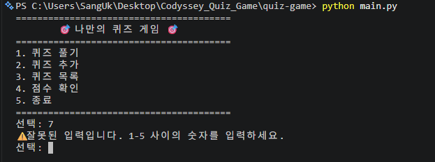
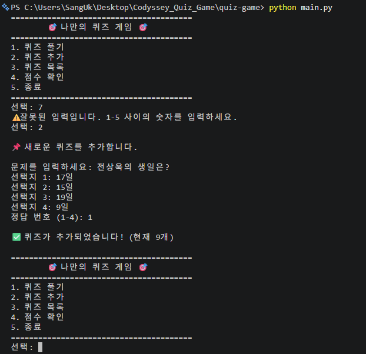
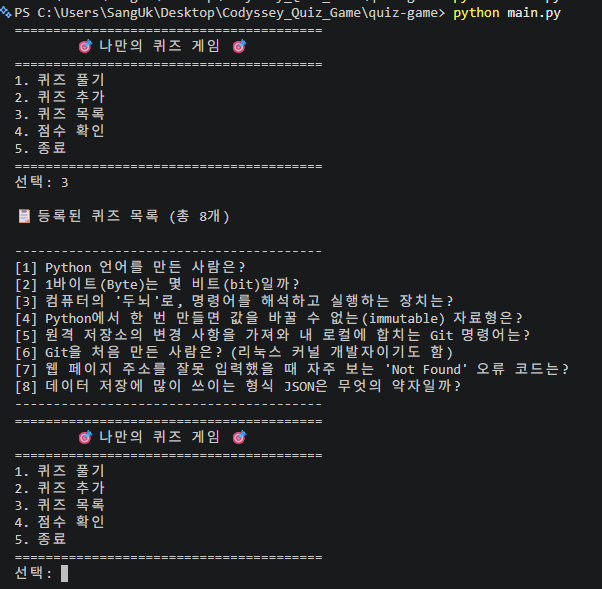
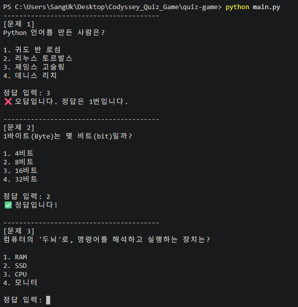
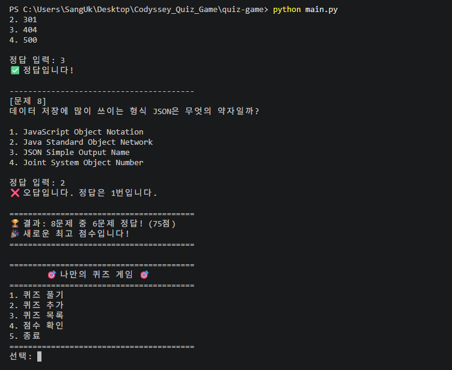
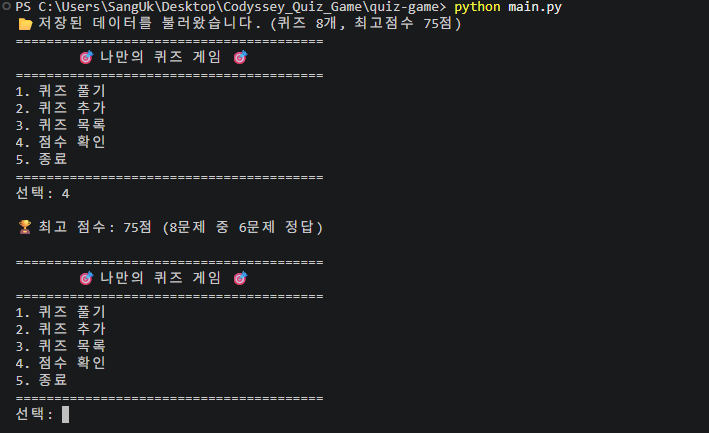
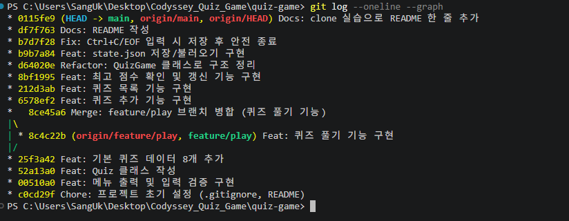
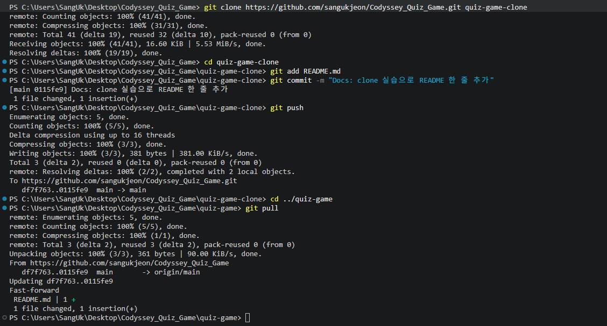
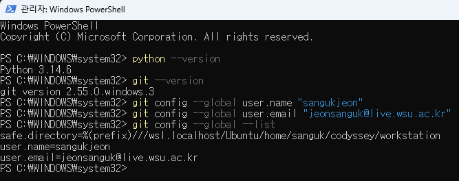

# 🎯 나만의 퀴즈 게임

터미널에서 실행하는 **컴퓨터 & 프로그래밍 기초 상식 퀴즈 게임**입니다.
(Codyssey 입학연수 미션: 컴퓨터에게 명령 내리는 말(파이썬) 처음 배우기)

---

## 1. 프로젝트 개요

- Python 기본 문법(변수, 조건문, 반복문, 함수)과 **클래스**로 만든 콘솔 퀴즈 게임입니다.
- 메뉴에서 번호를 골라 **퀴즈 풀기 / 퀴즈 추가 / 퀴즈 목록 / 점수 확인**을 할 수 있습니다.
- 추가한 퀴즈와 최고 점수는 `state.json` 파일에 저장되어, **프로그램을 껐다 켜도 유지**됩니다.
- 외부 라이브러리 없이 **Python 표준 라이브러리만** 사용했습니다.
- 개발 과정은 Git으로 기능 단위 커밋, 브랜치 생성 및 병합으로 관리했습니다.

## 2. 퀴즈 주제와 선정 이유

**주제: 컴퓨터 & 프로그래밍 기초 상식**

이번 미션에서 Python과 Git을 처음 배우면서 접한 개념(자료형, Git 명령어, JSON 등)과
컴퓨터 기초 상식을 퀴즈로 만들었습니다.
**게임을 만들면서 동시에 배운 내용을 복습**할 수 있고, 앞으로 개발 공부를 이어 갈 때
기초 개념을 다시 점검하는 데에도 쓸 수 있어서 이 주제를 선택했습니다.

## 3. 실행 방법

**개발 환경:** Python 3.10 이상 (개발: Python 3.14), 외부 라이브러리 설치 필요 없음

```bash
git clone https://github.com/sangukjeon/Codyssey_Quiz_Game.git
cd Codyssey_Quiz_Game
python main.py
```

> macOS / Linux에서는 `python3 main.py`로 실행합니다.

## 4. 기능 목록

| 메뉴 | 기능 | 설명 |
|---|---|---|
| 1 | 퀴즈 풀기 | 저장된 퀴즈를 순서대로 출제하고, 정답/오답을 바로 알려 줍니다. 모두 풀면 맞힌 개수와 점수(100점 만점)를 보여 줍니다. |
| 2 | 퀴즈 추가 | 문제, 선택지 4개, 정답 번호(1~4)를 입력해 새 퀴즈를 등록하고 파일에 저장합니다. |
| 3 | 퀴즈 목록 | 등록된 퀴즈의 문제를 번호와 함께 보여 줍니다. |
| 4 | 점수 확인 | 최고 점수와 그때의 정답 수를 보여 줍니다. 퀴즈를 풀 때마다 비교해 더 높으면 갱신하고 저장합니다. |
| 5 | 종료 | 프로그램을 종료합니다. |

**입력 및 예외 처리**
- 숫자 입력은 앞뒤 공백을 제거한 뒤 처리합니다. (예: ` 1 ` → `1`)
- 빈 입력, 숫자가 아닌 입력(`abc`), 범위 밖 숫자(메뉴 `9`, 정답 `0`)는 안내 메시지를 보여 주고 다시 입력받습니다.
- 퀴즈 추가 시 빈 문제나 빈 선택지는 다시 입력받습니다.
- 퀴즈가 없거나 아직 퀴즈를 풀지 않은 경우 안내 메시지를 보여 줍니다.
- `Ctrl+C`(KeyboardInterrupt)나 입력 스트림 종료(EOFError)가 발생해도 데이터를 저장하고 안전하게 종료합니다.
- `state.json`이 없으면 기본 퀴즈로 시작하고, 손상되었으면 안내 후 기본 퀴즈로 복구합니다.

## 5. 파일 구조

```
Codyssey_Quiz_Game/
├── main.py           # 실행 진입점: QuizGame 실행, Ctrl+C/EOF 안전 종료 처리
├── quiz_game.py      # QuizGame 클래스: 메뉴, 입력 처리, 풀기/추가/목록/점수, 저장/불러오기
├── quiz.py           # Quiz 클래스: 퀴즈 한 문제 (출력, 정답 확인, dict 변환/검증)
├── default_data.py   # 기본 퀴즈 8개 (첫 실행 또는 파일 손상 시 사용)
├── state.json        # 실행 중 자동 생성되는 데이터 파일 (Git에는 올리지 않음)
├── .gitignore        # Git 관리에서 제외할 파일 목록
├── README.md         # 프로젝트 설명
└── docs/
    └── screenshots/  # 실행 화면, Git 기록, 개발 환경 스크린샷
```

**클래스 구조**

| 클래스 | 속성 | 주요 메서드 |
|---|---|---|
| `Quiz` | `question`, `choices`, `answer` | `display()`, `is_correct()`, `to_dict()`, `from_dict()` |
| `QuizGame` | `quizzes`, `best`, `state_file` | `run()`, `show_menu()`, `input_number()`, `input_text()`, `play_quiz()`, `add_quiz()`, `list_quizzes()`, `show_score()`, `update_best_score()`, `save()`, `load()` |

**클래스를 사용한 이유 (함수만 쓸 때와의 차이)**

처음에는 `main.py`에 함수만으로 기능을 만들었는데, 퀴즈 목록(`quizzes`)과 최고 기록(`best`)을
`play_quiz(quizzes)`, `show_score(best)`처럼 **함수마다 인자로 계속 넘겨야** 했고,
최고 점수를 바꾸려면 반환값을 받아 다시 변수에 대입해야 했습니다. 기능이 늘수록 "어떤 데이터가 어디서 바뀌는지"
추적하기 어려워져서, 커밋 `d64020e Refactor: QuizGame 클래스로 구조 정리`에서 클래스로 바꿨습니다.

- **데이터와 기능을 한 곳에 묶음(캡슐화):** `Quiz`는 문제 한 개의 데이터(`question`, `choices`, `answer`)와
  그 데이터를 다루는 기능(`display`, `is_correct`, `to_dict`)을 함께 가집니다. 문제 형식이 바뀌어도 `Quiz`만 고치면 됩니다.
- **상태 공유:** `QuizGame`의 메서드들은 `self.quizzes`, `self.best`를 직접 읽고 바꾸므로 인자 전달이 사라지고,
  `save()`/`load()`도 `self`의 데이터를 그대로 저장/복원하면 됩니다.
- **역할 분리:** `Quiz`는 "문제 하나", `QuizGame`은 "게임 진행과 저장", `main.py`는 "실행과 비정상 종료 처리"만 담당합니다.
- **재사용:** `Quiz(...)`로 같은 틀의 객체를 몇 개든 만들 수 있어서, 기본 퀴즈 8개와 사용자가 추가한 퀴즈를 같은 방식으로 다룹니다.
- **함수만 쓸 때보다 나은 점 / 비용:** 작은 스크립트라면 함수만으로도 충분하지만, 상태(데이터)가 여러 기능에서 공유되고
  계속 변하는 프로그램에서는 클래스가 코드를 더 읽기 쉽게 만듭니다. 대신 구조를 설계하는 시간이 조금 더 듭니다.

## 6. 데이터 파일 설명 (`state.json`)

- **경로:** 프로젝트 루트의 `state.json` (`main.py`와 같은 폴더)
- **인코딩:** UTF-8 (한글이 그대로 보이도록 `ensure_ascii=False`로 저장)
- **역할:** 퀴즈 목록과 최고 점수를 저장해, 프로그램을 다시 실행해도 데이터를 유지합니다.
- **저장 시점:** 퀴즈를 추가할 때, 최고 점수가 갱신될 때, `Ctrl+C`/EOF로 종료될 때
- **생성:** 첫 실행 시 파일이 없으면 기본 퀴즈로 자동 생성됩니다.
- **Git 관리:** 실행할 때마다 바뀌는 데이터라 `.gitignore`에 넣어 저장소에는 올리지 않습니다.

**스키마**

| 키 | 타입 | 설명 |
|---|---|---|
| `quizzes` | list | 퀴즈 목록 |
| `quizzes[].question` | str | 문제 |
| `quizzes[].choices` | list[str] | 선택지 4개 |
| `quizzes[].answer` | int | 정답 번호 (1~4) |
| `best_score` | int 또는 null | 최고 점수 (100점 만점, 아직 기록이 없으면 `null`) |
| `best_correct` | int 또는 null | 최고 점수일 때 맞힌 문제 수 |
| `best_total` | int 또는 null | 최고 점수일 때 전체 문제 수 |

**예시**

```json
{
  "quizzes": [
    {
      "question": "Python 언어를 만든 사람은?",
      "choices": ["귀도 반 로섬", "리누스 토르발스", "제임스 고슬링", "데니스 리치"],
      "answer": 1
    }
  ],
  "best_score": 67,
  "best_correct": 6,
  "best_total": 9
}
```

**필드 설계 이유**

| 설계 | 이유 |
|---|---|
| 최상위를 객체(`{}`)로 두고 `quizzes`와 `best_*`를 나란히 배치 | 프로그램의 상태가 "퀴즈 목록"과 "최고 기록" 두 덩어리이므로, 키 이름만 보고 무엇이 들어 있는지 알 수 있게 했습니다. 나중에 `history` 같은 키를 추가해도 기존 키와 충돌하지 않습니다. |
| `quizzes`는 객체의 배열 (중첩 구조) | 퀴즈 하나는 문제, 선택지, 정답이 **항상 함께** 움직이는 한 단위입니다. 문제끼리 순서도 있으므로 배열(list)에 담고, 각 원소는 `Quiz.to_dict()` 결과와 같은 모양으로 만들어 `Quiz.from_dict()`로 그대로 복원되게 했습니다. |
| `choices`는 길이 4의 문자열 배열 | 선택지를 `choice1`~`choice4` 키로 나누면 반복문으로 다루기 어렵습니다. 배열이면 `enumerate`로 번호를 붙여 출력하고, 개수(4개)도 `len()`으로 검증할 수 있습니다. |
| `answer`는 1~4의 정수 (정답 텍스트가 아님) | 사용자가 입력하는 값이 번호이므로 그대로 비교할 수 있고(`user_answer == answer`), 선택지 문구를 고쳐도 정답이 깨지지 않습니다. 화면에 보이는 번호와 같게 1부터 시작합니다. |
| `best_score`, `best_correct`, `best_total`을 따로 저장 | 점수(%)만 저장하면 "8문제 중 6문제"처럼 **몇 문제 중 몇 개를 맞혔는지** 복원할 수 없습니다. 반대로 맞힌 개수만 저장하면 문제 수가 바뀌었을 때(8문제 → 9문제) 공정하게 비교할 수 없습니다. 그래서 **비교 기준은 점수(`best_score`)**, **화면 표시용으로 `best_correct`와 `best_total`** 을 함께 둡니다. 과제 예시의 `best_score` 키 이름은 그대로 유지했습니다. |
| 최고 기록은 최상위에 평평하게(flat) 저장 | 값이 세 개뿐이고 항상 함께 쓰이므로 한 단계 더 중첩하지 않고, `best_score`만 읽는 단순한 도구와도 호환되게 했습니다. |
| 기록이 없으면 `null` | 0점과 "아직 풀지 않음"을 구분하기 위해서입니다. 0으로 시작하면 0점을 받은 사람과 안 푼 사람을 구별할 수 없습니다. |
| 불러올 때 형식 검증 | `Quiz.from_dict()`가 선택지 개수, 정답 범위, 타입을 확인하고, 하나라도 틀리면 손상된 파일로 보고 기본 데이터로 복구합니다. |

**JSON 저장 방식의 한계와 대안**

이 프로젝트는 데이터가 퀴즈 수십 개 수준이라 JSON이 가장 단순하고 적절하지만, 다음과 같은 한계가 있습니다.

| 한계 | 설명 |
|---|---|
| 저장할 때마다 파일 전체를 다시 씀 | 퀴즈 1개를 추가해도 전체 목록을 직렬화해서 덮어씁니다. 데이터가 많아질수록 저장 시간이 데이터 크기에 비례해 늘어납니다. |
| 불러올 때 전체를 메모리에 올림 | `json.load()`는 파일 전체를 한 번에 읽어 객체로 만듭니다. 수십만 건 이상이면 메모리 사용량과 시작 시간이 커집니다. |
| 검색/정렬 기능이 없음 | "특정 단어가 들어간 문제 찾기"도 전체를 읽은 뒤 Python에서 직접 반복해야 합니다. |
| 동시 접근에 약함 | 프로그램 두 개가 동시에 저장하면 나중에 쓴 쪽이 앞의 내용을 덮어씁니다. 잠금(lock)이나 트랜잭션 기능이 없습니다. |
| 저장 중 중단 시 손상 위험 | 이 문제는 **임시 파일에 먼저 쓰고 `os.replace()`로 교체**하는 방식으로 줄였고, 그래도 손상되면 기본 데이터로 복구합니다. |

| 대안 | 장점 | 단점 | 이 프로젝트에서 |
|---|---|---|---|
| **JSON** (현재) | 사람이 읽고 고칠 수 있음, `dict`/`list`와 바로 변환, 표준 라이브러리 | 위의 한계 | ✅ 데이터가 작아 가장 적합 |
| **CSV** | 표 형태라 엑셀로 열기 쉬움 | 선택지 4개 같은 중첩 구조 표현이 불편 | ❌ |
| **SQLite** (`sqlite3`, 표준 라이브러리) | 필요한 행만 읽고 쓰기, SQL 검색/정렬, 트랜잭션으로 손상 방지 | 테이블 설계와 SQL 작성 필요, 파일을 직접 열어 보기 어려움 | 퀴즈가 수천 개 이상이거나 점수 기록(히스토리)이 쌓이면 전환 고려 |
| **서버 DB** (MySQL, PostgreSQL 등) | 여러 사용자가 동시에 사용, 대용량 처리 | 별도 서버 설치/운영 필요, 외부 라이브러리 필요 | ❌ 과제 범위(외부 라이브러리 금지) 밖 |

## 7. Git 작업 기록

| 명령어 | 하는 일 | 이 프로젝트에서 사용한 곳 |
|---|---|---|
| `git init` | 현재 폴더를 Git 저장소로 만든다 | 프로젝트 시작 |
| `git add` | 변경된 파일을 커밋할 대상(스테이징)에 올린다 | 매 기능 완성 후 |
| `git commit` | 스테이징된 변경을 하나의 기록으로 저장한다 | 기능 단위 커밋 |
| `git push` | 로컬 커밋을 GitHub 원격 저장소로 올린다 | 커밋 후 업로드 |
| `git checkout` | 브랜치를 만들거나 이동한다 | `feature/play` 브랜치 작업 |
| `git merge` | 다른 브랜치의 작업을 현재 브랜치에 합친다 | `feature/play` → `main` 병합 |
| `git clone` | 원격 저장소를 통째로 내 컴퓨터에 복제한다 | 복제 실습 |
| `git pull` | 원격 저장소의 새 커밋을 가져와 합친다 | 복제 실습 후 반영 |

- 2026-11-08: clone/pull 실습 완료

### 커밋 메시지 규칙

기능 하나를 완성할 때마다 커밋하고, 메시지는 `타입: 변경 요약` 형식으로 씁니다.
필요하면 본문(`-m`을 한 번 더)에 무엇을 바꿨는지 목록으로 적습니다.

| 타입 | 사용하는 경우 | 이 프로젝트의 예 |
|---|---|---|
| `Feat` | 새로운 기능 추가 | `Feat: 퀴즈 추가 기능 구현` |
| `Fix` | 버그 수정, 예외 처리 보완 | `Fix: Ctrl+C/EOF 입력 시 저장 후 안전 종료` |
| `Refactor` | 동작은 같고 구조만 개선 | `Refactor: QuizGame 클래스로 구조 정리` |
| `Docs` | README 등 문서 수정 | `Docs: README 작성` |
| `Chore` | 설정 파일 등 기능 외 작업 | `Chore: 프로젝트 초기 설정 (.gitignore, README)` |
| `Merge` | 브랜치 병합 | `Merge: feature/play 브랜치 병합 (퀴즈 풀기 기능)` |

- 요약은 한 줄로, "무엇을 했는지"가 드러나게 씁니다. (`수정`, `update` 같은 형식적인 메시지는 쓰지 않음)
- 한 커밋에는 한 가지 기능/목적만 담습니다.

```bash
git commit -m "Feat: state.json 저장/불러오기 구현" -m "- 파일이 없으면 기본 퀴즈로 시작, 손상 시 기본 데이터로 복구"
```

### 커밋 기록 (`git log --oneline --graph`)

아래는 README 문서 보완 직전 시점의 기록입니다. **커밋 15개**(병합 커밋 1개 포함)이며,
이 문서 보완 커밋까지 포함하면 16개입니다. `feature/play` 브랜치에서 작업한 뒤 `main`으로 병합한 갈래가 보입니다.

```
* 40baaf2 Docs: README에 실행 화면 스크린샷 추가
* 0115fe9 Docs: clone 실습으로 README 한 줄 추가
* df7f763 Docs: README 작성
* b7d7f28 Fix: Ctrl+C/EOF 입력 시 저장 후 안전 종료
* b9b7a84 Feat: state.json 저장/불러오기 구현
* d64020e Refactor: QuizGame 클래스로 구조 정리
* 8bf1995 Feat: 최고 점수 확인 및 갱신 기능 구현
* 212d3ab Feat: 퀴즈 목록 기능 구현
* 6578ef2 Feat: 퀴즈 추가 기능 구현
*   8ce45a6 Merge: feature/play 브랜치 병합 (퀴즈 풀기 기능)
|\
| * 8c4c22b Feat: 퀴즈 풀기 기능 구현
|/
* 25f3a42 Feat: 기본 퀴즈 데이터 8개 추가
* 52a13a0 Feat: Quiz 클래스 작성
* 00510a0 Feat: 메뉴 출력 및 입력 검증 구현
* c0cd29f Chore: 프로젝트 초기 설정 (.gitignore, README)
```

### clone / pull 실습 기록

```text
# 1) 별도 폴더에 저장소 복제
PS ...\Codyssey_Quiz_Game> git clone https://github.com/sangukjeon/Codyssey_Quiz_Game.git quiz-game-clone

# 2) 복제본에서 README 한 줄 추가 → commit → push
PS ...\quiz-game-clone> git add README.md
PS ...\quiz-game-clone> git commit -m "Docs: clone 실습으로 README 한 줄 추가"
[main 0115fe9] Docs: clone 실습으로 README 한 줄 추가
PS ...\quiz-game-clone> git push
   df7f763..0115fe9  main -> main

# 3) 기존 작업 폴더에서 pull → 변경 사항 반영 확인
PS ...\quiz-game> git pull
Updating df7f763..0115fe9
Fast-forward
 README.md | 1 +
```

## 8. 실행 화면

| 메뉴 및 잘못된 입력 처리 | 퀴즈 추가 |
|---|---|
|  |  |

| 퀴즈 목록 | 퀴즈 풀기 (정답/오답) |
|---|---|
|  |  |

| 퀴즈 결과 및 최고 점수 갱신 | 재실행 후 데이터 유지 + 점수 확인 |
|---|---|
|  |  |

**Git 커밋 그래프 (`git log --oneline --graph`)**



**clone / pull 실습**



**개발 환경**


